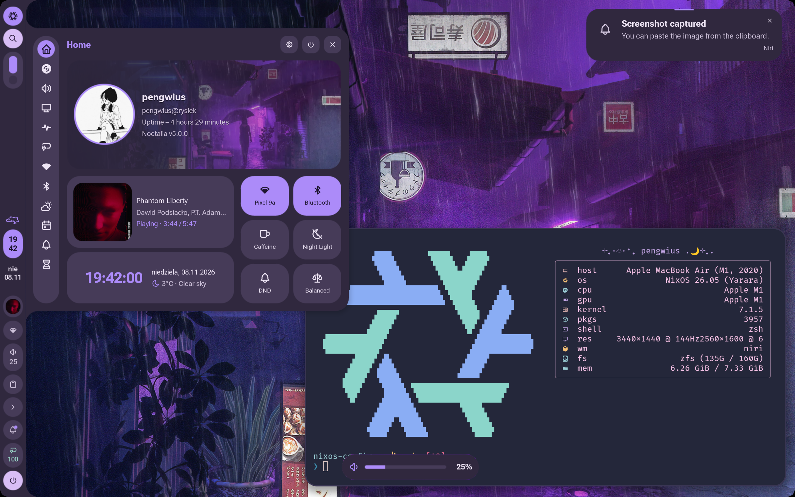
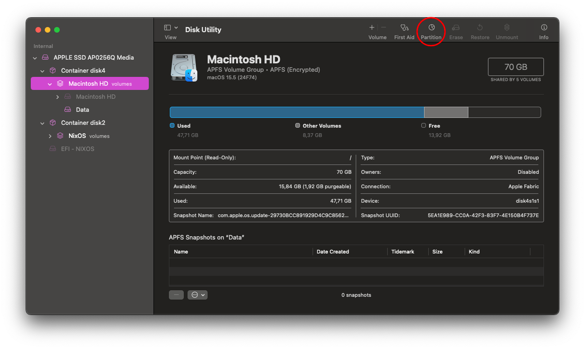
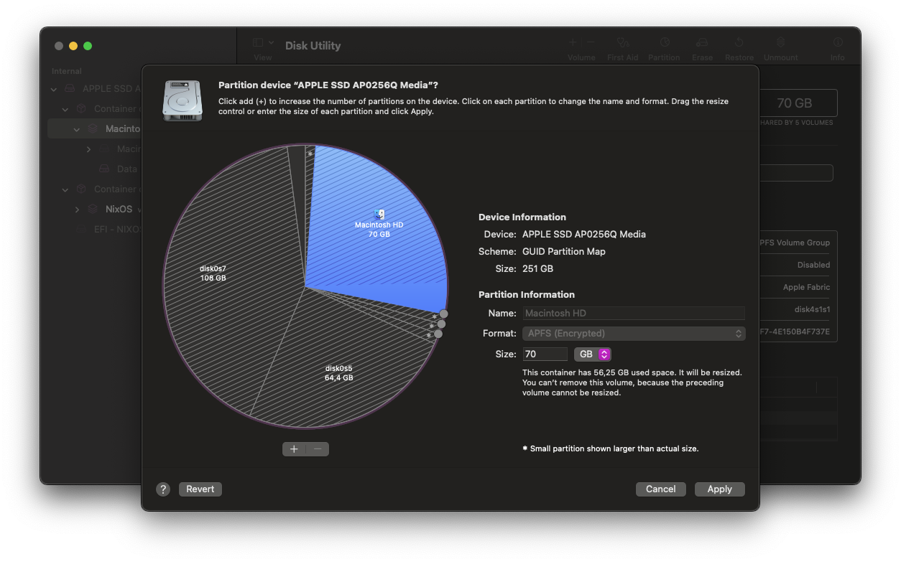

# ❄️ NixOS config



This configuration is based on [@SailorSnow's](https://github.com/SailorSnoW) config. He did an amazing job with it - thank you!

This repository contains my personal NixOS configuration for Apple Silicon (Asahi Linux), an older Intel MacBook Air and a Lenovo Y50-70. Home Manager is integrated directly into the NixOS builds.

I am using this configuration as my daily driver on a MacBook Air M1. It currently includes the experimental Asahi Linux branch with working external display support via USB-C.

The `asahi` host uses ZFS for `/` and `/home`; `gruchot` and `y50-70` use ext4. All three use ZRAM; `asahi` and `gruchot` also share low-memory tuning.

## 🎨 Rice: Material Design 3 Expressive

The rice is based on **Material Design 3 Expressive**: a dark lavender palette, rounded surfaces, capsule-shaped controls and expressive workspace indicators.

- **Niri** is the Wayland compositor; **Noctalia** is the desktop shell.
- Firefox has a custom M3 Expressive-inspired theme.
- GNOME applications and developer tools provide the everyday toolset. GTK styling follows Noctalia's palette.
- DejaVu Sans and FiraCode fonts, Papirus-Dark icons and the Bibata-Modern-Ice cursor complete the desktop styling. Stylix still themes other supported applications.

## 🖥️ Hosts

| Flake output | System hostname | Hardware | Platform | Storage / memory |
| --- | --- | --- | --- | --- |
| `asahi` | `rysiek` | MacBook Air M1 | `aarch64-linux`, asahi | ZFS + ZRAM |
| `gruchot` | `gruchot` | MacBook Air 2014 Intel Core 2 Duo | `x86_64-linux` | ext4 + ZRAM |
| `y50-70` | `y50-70` (working name) | Lenovo Y50-70, Intel + NVIDIA Optimus | `x86_64-linux` | ext4 + ZRAM |

I will guide you through the entire installation process. Please note that these instructions **might not be complete**, as I wrote them from memory step-by-step and may have overlooked some details. If you encounter any issues, feel free to contact me on [Telegram](https://t.me/pengwius) or Matrix: `@pengwius:matrix.org`. I will be more than happy to help you and update the instructions.

—

# Installing on Apple Silicon (`asahi`)

The following guide is for `asahi`.

## 0. Shrinking the macOS Partition

If you no longer rely on macOS and want to shrink it as much as possible, use Disk Utility to do so manually. **Do not use the Asahi tool for this step**, as it reserves too much space for macOS and will not allow you to minimize the partition size fully.

<div style="display:flex; gap:10px; align-items:center; flex-wrap:wrap;">
  
  
</div>

## 1. Installing NixOS

Follow the steps provided here: https://github.com/nix-community/nixos-apple-silicon/blob/main/docs/uefi-standalone.md.

**However**, when creating the ext4 partition, only use **half** of the available free space. Leave the other half unallocated.

You could alternatively use the entire space and shrink the ext4 partition later, but this is unnecessary unless your disk space is so limited that it cannot handle the initial system build (including the kernel). You may want to run `nix-collect-garbage -d` in the future after the system builds to free up disk space.

## 2. Installing the Configuration

Clone my configuration into your user home directory:

```bash
git clone https://github.com/pengwius/nixos-config
cd nixos-config
```

Replace `pengwius` with your username in the following files:
- `/flake.nix`
- `/home-manager/home.nix`
- `/hosts/asahi/configuration.nix`
- `/hosts/common/users.nix`
- `/modules/home-manager/gui/firefox.nix`

Update `fileSystems."/"` in `/hosts/asahi/hardware-configuration.nix` to:

```nix
fileSystems."/" = {
  device = "/dev/disk/by-uuid/<ext4 partition uuid>";
  fsType = "ext4";
};
```

Change the disk UUID in `fileSystems."/boot"` to match yours, and comment out `fileSystems."/home"` during the initial ext4 installation. Leave disk-backed `swapDevices` unset; ZRAM is already configured.

You can retrieve your UUID by running `lsblk -f` or `blkid`.

Now, rebuild your system by running:

```bash
sudo nixos-rebuild switch --flake .#asahi
```

This will likely take some time, as it needs to compile the entire kernel.
Once complete, set a password for your user:

```bash
passwd <your username>
```

Finally, reboot your system.

## 3. Creating the ZFS Partition

Now, create the ZFS partition in the free space you left in Step 1.

Run the following command:

```bash
sudo zpool create \
  -o ashift=12 \
  -O compression=zstd \
  -O atime=off \
  -O xattr=sa \
  -O acltype=posixacl \
  -O encryption=aes-256-gcm \
  -O keyformat=passphrase \
  -O keylocation=prompt \
  zroot /dev/<your free partition (likely nvme0n1p6, but verify this yourself!)>
```

You will be prompted to enter a password to encrypt the filesystem.

Next, create the ZFS datasets:

```bash
sudo zfs create zroot/nixos
sudo zfs create zroot/nixos/home
```

And set up the mountpoints:

```bash
sudo zfs set mountpoint=legacy zroot/nixos
sudo zfs set mountpoint=legacy zroot/nixos/home
```

## 4. Migrating the System from ext4 to ZFS

First, mount the ZFS partition:

```bash
sudo mount -t zfs zroot/nixos /mnt
```

Copy the entire system to ZFS:

```bash
sudo rsync -aAXHv --numeric-ids \
    --exclude={"/dev/*","/proc/*","/sys/*","/tmp/*","/run/*","/mnt/*","/media/*","/lost+found"} \
    / /mnt
```

Then copy the home directory:

```bash
sudo rsync -aAXHv /home/ /mnt/home
```

## 5. Configuring the System on ZFS

Chroot into the system on ZFS:

```bash
nixos-enter --root /mnt
```

Edit `/hosts/asahi/hardware-configuration.nix` in the config and update `fileSystems` to:

```nix
  fileSystems."/" = {
   device = "zroot/nixos";
   fsType = "zfs";
 };

 fileSystems."/home" = {
   device = "zroot/nixos/home";
   fsType = "zfs";
 };
```

Mount the EFI partition:

```bash
mount /dev/nvme0n1p4 (Check which partition holds YOUR EFI!) /boot
```

Proceed with the rebuild:

```bash
nixos-rebuild boot --flake .#asahi
```

After this, exit the chroot and reboot the system. It should boot into the ZFS installation.

## 6. Adding the ext4 Partition to the zpool

Once booted into your fresh ZFS system, you may want to add the remaining ext4 partition to the pool to utilize the full disk space. There is no need to resize partitions; you can simply wipe the ext4 partition and add it to the zpool.

Run:

```bash
sudo wipefs -a /dev/nvme0n1p5 (This might differ for you! Check carefully!)
```

And then:

```bash
sudo zpool add zroot /dev/nvme0n1p5
```

Verify that everything went correctly by running:

```bash
zpool list
zfs list
```

## 7. Swap / ZRAM

ZRAM swap is enabled declaratively by `hosts/features/lowmem.nix` on `asahi` and `gruchot`, and directly in `hosts/y50-70/configuration.nix` on the Lenovo; no manual swap creation is needed. **Do not create swap on a ZFS zvol**: it can deadlock under memory pressure. The current configuration uses ZRAM only.

—

## 🔧 Build, Test, Update

- Evaluate/check flake:
  ```bash
  nix flake check
  ```
- Build a system closure without activating it (use `gruchot` or `y50-70` for the Intel hosts):
  ```bash
  nix build --no-link .#nixosConfigurations.asahi.config.system.build.toplevel
  ```
- Activate on the matching machine, after adapting its hardware configuration:
  ```bash
  sudo nixos-rebuild switch --flake .#asahi
  # On the Intel MacBook Air instead:
  sudo nixos-rebuild switch --flake .#gruchot
  ```
- Update inputs:
  ```bash
  nix flake update
  ```

—

## 📦 Repository Structure

- `flake.nix` / `flake.lock`: Inputs, locks, `mkHost` helper, host outputs and integrated Home Manager. Stable/unstable package sets are passed as module arguments here.
- `hosts/`
  - `asahi/`: Apple Silicon host settings and real hardware/filesystem configuration; imports the local Apple Silicon modules and ZFS feature.
  - `gruchot/`: Intel host settings and hardware template; imports neither Asahi nor ZFS.
  - `y50-70/`: Lenovo host settings and supplied ext4/EFI hardware configuration; NVIDIA PRIME, Broadcom Wi-Fi and gaming support.
  - `common/`: Shared system base: boot, users, locale, Nix/Lix settings, packages, containers, console shim and rebuild helper.
  - `features/desktop.nix`: Shared GNOME applications/services, SDDM + SilentSDDM login screen, and base Stylix settings.
  - `features/lowmem.nix`: ZRAM, OOM handling and memory/watchdog tuning for `asahi` and `gruchot`.
  - `features/zfs.nix`: ZFS kernel integration, snapshots, scrubbing, TRIM and ARC limit; used by `asahi`.
- `home-manager/home.nix`: User entrypoint: module imports, CLI/GUI packages, Git, direnv and managed files. GUI imports/packages are gated by `enableGui`.
- `home-manager/assets/`: Wallpapers and profile pictures, also installed into `~/Pictures/`.
- `modules/`
  - `modules/nixos/default.nix`: NixOS module export set, currently empty; shared system configuration lives under `hosts/`.
  - `modules/home-manager/default.nix`: Home Manager module exports.
  - `modules/home-manager/noctalia/`: Authoritative shell settings, M3 Expressive palette, rail, widgets and lock screen.
  - `modules/home-manager/gui/niri/`: Generated Niri configuration, bindings, window rules and window-memory helper. Display settings live in a separate `outputs.kdl`, overridable per host.
  - `modules/home-manager/gui/gnome.nix`: GTK 3/4 styling derived from Noctalia, fonts, icons, cursor, dconf and default file handlers.
  - `modules/home-manager/gui/firefox.nix` + `modules/home-manager/gui/firefox/material-expressive.css`: Firefox profile, vertical tabs and custom browser styling.
  - `modules/home-manager/gui/`: Other application settings, including Ghostty, Zed, VS Code and Vesktop.
  - `modules/home-manager/neovim/`: Neovim plugins and Lua configuration through Home Manager's `programs.neovim`.
  - `modules/home-manager/`: CLI/editor modules such as Zsh, Yazi, btop, Helix, fastfetch and Android SDK settings.
- `overlays/default.nix`: Exposes local packages through `additions`; `modifications` pins the verified Copilot.lua release commit and source hash while the locked Nixpkgs hash is stale.
- `pkgs/`: Custom `materialfy`, `pixelgram` and `nokia-fonts` packages, exported by `default.nix`. pixelGram's ARM64/Wayland patches and regression checks live alongside its package.
- `apple-silicon-support/`: Local Apple Silicon NixOS modules and packages, including kernel/platform support.
- `dotfiles/`: Standalone fastfetch and Niri files; the active Niri configuration is generated by Home Manager, not copied from here.
- `screenshots/`: Rice and installation screenshots.

—

## 🧩 Notable Choices

- Desktop: Niri + Noctalia; SDDM with SilentSDDM as the login manager. The Lenovo additionally keeps KDE Plasma as its default session.
- Applications: GNOME core apps and developer tools, plus Evolution, File Roller, backups and Software/Flatpak; Firefox, Ghostty, Zed, Vesktop, Materialfy and pixelGram.
- Theming: M3 Expressive-inspired Noctalia, Firefox and GTK styling.
- Podman: Enabled with Docker compatibility and `podman-compose`.

-

## ❄️ Notes

This is a personal setup tuned for my hardware and workflow. Feel free to explore and adapt it.
